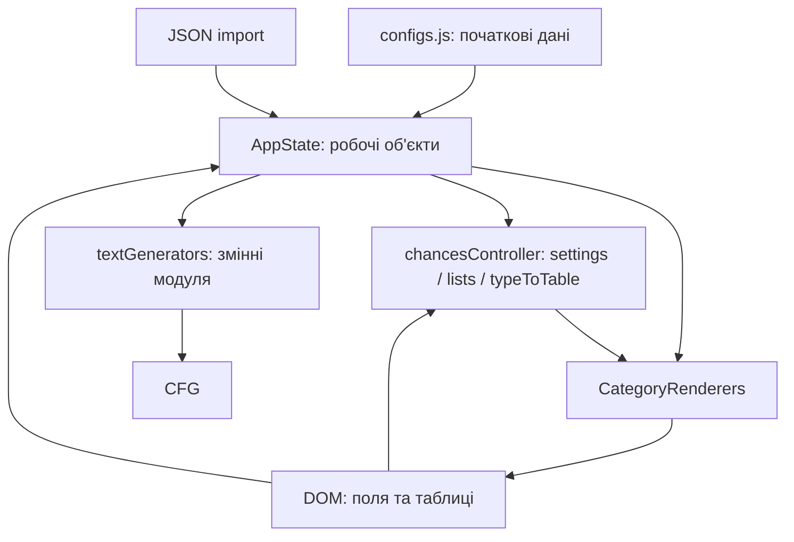
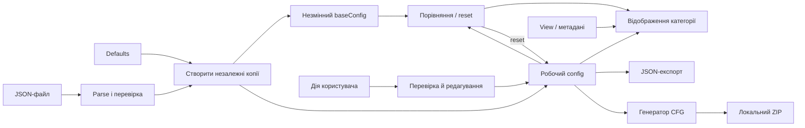

# Оцінка архітектури фронтенду

Дата: 5 жовтня 2026 року. Уточнено 7 жовтня 2026 року. Доповнення до FRONTEND_AUDIT.md: вихідні спостереження та погоджений напрямок архітектури; це не звіт про завершення реалізації.

Предметний контекст і терміни збережені в [PROJECT_CONTEXT.md](PROJECT_CONTEXT.md). Актуальний обсяг, порядок реалізації та статуси рев'ю — у [TODO_REFACTOR.md](TODO_REFACTOR.md); цей огляд пояснює рішення й альтернативи.

**Рішення власника від 6 жовтня 2026 року:** весь власний програмний код фронтенд-проєкту має перейти на TypeScript. Міграція вже розпочата з model/defaults; її кінцевий обсяг включає також UI, REST/PresetsManager, фронтенд-виклик PAK, тести, скрипти й виконувані конфігурації інструментів. Попередні пропозиції обмежитися локальним ядром більше не визначають обсяг. Порядок робіт і зупинки для рев'ю — у плані; бекенд і мережеві контракти залишаються незмінними.

## 1. Вердикт

**Дані поточної конфігурації в пам'яті потрібні. Нинішня система класів, менеджерів і ручного переприв'язування цих даних — у такому вигляді не потрібна.**

Для цього проєкту достатньо одного робочого об'єкта конфігурації, невеликого об'єкта стану екрана, функцій перевірки/редагування і генератора CFG. Окремий state-management framework, підписки на кожне поле, глобальна шина подій, reducer/action-система та localStorage для цього не потрібні.

Поточний поділ на модулі варто зберегти за призначенням, але спростити реалізацію. Найбільшу користь дадуть чітке володіння даними й відокремлення генератора від UI. Переписування на React/Vue або створення власного мініфреймворку не випливає з потреб цього редактора.

| Аспект | Оцінка | Причина |
| --- | --- | --- |
| Обраний стек | Придатний після погодженої TS-міграції | Vanilla TypeScript + Vite + Bootstrap; UI-фреймворк для форм, таблиць, JSON та ZIP не потрібний |
| Розбиття за призначенням | Частково вдале | Є окремі дані, генератор, UI та REST, але межі відповідальності порушені |
| Володіння даними | Основна архітектурна проблема | Кілька шарів зберігають посилання на ті самі вкладені об'єкти, а заміна стану не синхронізована |
| Абстракції | Надмірні місцями, слабкі на важливих межах | Є менеджери й setter-и без гарантій, але немає єдиного правила застосування конфігурації |
| Генератор | Корисне ядро, потребує ізоляції | Генерує CFG без DOM/REST, проте використовує змінні модуля та залежить від форми AppState |
| Тестованість | Можна суттєво покращити без нового фреймворку | Стан і CFG вже можна перевіряти в Node; ZIP не потребує беку |

Це оцінка конкретної реалізації. Саме використання класів чи файлу state.js не є дефектом.

## 2. Що означає «стан» і до чого тут localStorage

Коли користувач змінює шанс для Neutral, переходить до Bandit, а потім завантажує ZIP, програма має пам'ятати зміни Neutral. Оскільки таблиця Neutral вже видалена з DOM, ці дані повинні залишатися десь у пам'яті. Об'єкт зі значеннями — це і є стан редактора, навіть якщо він називається просто `config`.

| Поняття | Навіщо потрібне | Чи потрібно зараз |
| --- | --- | --- |
| Робоча конфігурація в пам'яті | Зберігати введені значення між перемиканнями екрана і передати їх генератору | Так |
| Стан екрана | Пам'ятати вибрані фракцію, категорію, пошуковий запит | Так, у мінімальному вигляді |
| JSON import/export | Зберегти конфігурацію у файл і відновити її | Уже є; потрібно виправити |
| LocalStorage/IndexedDB | Відновити роботу після закриття чи перезавантаження вкладки | Лише якщо потрібна така функція |
| Серверні пресети | Обмін і зберігання через бекенд | Наявний окремий сценарій; зараз не переробляємо |
| Бібліотека керування станом | Підписки, складні залежності, інструменти відстеження | Потреби в ній для поточного масштабу не видно |

Відсутність localStorage не робить стан зайвим. Вона означає, що він живе лише до перезавантаження сторінки. Ручний JSON-експорт зберігається. Незалежний baseConfig, порівняння з ним і reset уже входять до погодженого плану; автозбереження та захист незбереженої роботи залишаються окремими можливостями.

Зберігати всю конфігурацію тільки в DOM тут незручно: більшість категорій у кожен момент узагалі не відображається; input повертає рядки; імпорт та генерація тоді залежали б від того, які поля зараз змонтовані. Типізований об'єкт конфігурації в пам'яті простіший і надійніший.

## 3. Що насправді відбувається зараз

Нижче збережено спостереження вихідного аудиту від 5 жовтня 2026 року. Поточну реалізацію після етапу 1 описує PROJECT_CONTEXT.md; зокрема, defaults/model уже на TS, а AppState має один config і незалежний baseConfig.



Це не три незалежні повні копії конфігурації. Після стартового deep copy більшість наступних «шарів стану» містить **посилання на ті самі об'єкти**:

- `state.modifiedWeaponSettings` і `controller.settings.weapon` спочатку тотожні.
- `state.typeToTable.weapon` посилається на `state.modifiedWeaponList`.
- `state.exportState().WeaponSettings` також повертає саме робочий об'єкт, а не незалежний snapshot.
- Генератор копіює посилання з AppState у свої `modified*`, а частину з них ще й у `oWeaponList`, `oWeaponLoadoutSettings` тощо.

Тому це передусім проблема керування посиланнями й відповідальністю, а не доведена проблема великого споживання пам'яті. Серіалізована початкова конфігурація під час перевірки займала приблизно 20.6 KB UTF-8; це розмір JSON, не вимір heap. Для таких даних спеціальна система кешування зараз нічим не обґрунтована.

### AppState не гарантує централізованих змін

`src/js/state.js` має setter-и, але поля публічні, а UI і контролери регулярно змінюють їх напряму. Частина setter-ів просто присвоює значення; лише деякі оновлюють похідні таблиці. `exportState()` і `getChancesSettings()` вручну описують дві різні проєкції тих самих даних. Пропуск pistol у другій уже спричинив F02.

Методи `updateWeaponSettings`, `updateArmorSettings`, `updateHelmetSpawnSettings`, `updateGrenadeSettings`, `updateAmmoSettings`, `updatePistolSettings`, `updatePistolSpawnChance`, `resetState` за пошуком у поточному src не мають викликів поза своїми визначеннями. Вони створюють видимість повного API, але реальний шлях редагування проходить повз них.

`resetState()` замінює поля через `Object.assign(this, new AppState())`. При прямій перевірці це залишило і `controller.settings.weapon`, і `controller.typeToTable` прив'язаними до старих об'єктів. У поточному UI reset не викликається, тому це дефект заготовленого методу, а не додатковий підтверджений користувацький сценарій.

### chancesController поєднує забагато ролей

`src/js/chances.js` одночасно зберігає фракцію/категорію, кешує посилання, будує DOM, розраховує відсотки, обробляє input, додає/видаляє предмети й показує власний діалог. Назва «контролер шансів» не описує фактичного обсягу.

CategoryRenderers при цьому теж створює DOM і частково змінює стан. EventManager теж змінює навігацію, керує UI і реалізує JSON import/export. Application додає ще один спосіб вибору renderer-а після завантаження. Результат — один сценарій розподілений між кількома об'єктами з неузгодженими правилами.

### Генератор ізольований лише частково

`textGenerators.js` уже не потребує браузерного DOM чи мережі для створення CFG — це варто зберегти. Однак `createLoadout(appState)` спочатку заповнює змінні модуля, після чого допоміжні функції неявно читають їх. Для розуміння функції недостатньо подивитися на її аргументи.

У чинному виконуваному тілі createLoadout немає await, хоча функція async. Тому сам факт змінних модуля **не доводить поточну race condition**: зараз генерація проходить синхронно до повернення Promise. Недолік тут у неявних залежностях, складності ізольованих перевірок і крихкості при майбутніх змінах.

## 4. Що залишити, спростити й прибрати

Оцінки нижче — цільова рекомендація. «Прибрати» не означає видалити файл без перенесення потрібної поведінки та перевірки його викликів.

| Частина | Рішення | Що саме |
| --- | --- | --- |
| Vanilla TypeScript, ES modules, Vite | **Цільовий стек** | Повна TS-міграція обов'язкова; зберігаємо Vite й роботу без UI-фреймворку |
| Bootstrap | **Залишити й упорядкувати** | Використовувати як єдину основу UI; очистити старі стилі й lifecycle діалогів |
| configs.js | **Залишити дані** | Початкова копія для редагування потрібна. За потреби відділити незмінні каталоги від defaults; не розбивати на десятки файлів лише заради структури |
| AppState | **Спростити; клас необов'язковий** | Зберегти створення початкової конфігурації та імпорт/експорт; прибрати зайві setter-и й ручні похідні копії. На час переходу клас може бути сумісною оболонкою |
| `modified*` і wire-назви `WeaponSettings` тощо | **Не перейменовувати все одразу** | Вибрати один внутрішній формат пізніше; поточний формат JSON і доступ наявних споживачів спершу зберегти |
| chancesController як багатофункціональний клас | **Прибрати в цільовій структурі** | Зберегти корисні розрахунки як функції, побудову таблиць як UI-функції, редагування як кілька явних операцій |
| `fillSettings`, `getChancesSettings`, кешовані settings/lists/typeToTable | **Прибрати ручну синхронізацію** | Читати актуальний config під час render/дії; списки предметів отримувати функціями. На першому кроці можна виправити контракт без повної перебудови |
| CategoryRenderers | **Залишити призначення, спростити** | Renderer-и за категоріями доречні; клас і посилання на chancesController не обов'язкові |
| EventManager | **Спростити** | Навігацію й toolbar прив'язати у bootstrap застосунку; обробники полів залишити біля відповідних компонентів; JSON винести зі «менеджера подій» |
| Application | **Звести до точки складання** | Одноразово створити модель, прив'язати події й показати екран; прибрати зайві таймери, порожній subscribeToExistingEvents та зайву ініціалізацію |
| `window.S2App` | **Лише за потреби для debug** | Не робити публічним каналом мутації; не потрібен для роботи редактора |
| DOM helper-и | **Залишити вибірково** | Спільні number field, chance row, table, dialog корисні. Обгортка `setTextContent(el, text)` не додає цінності порівняно з `el.textContent = text` |
| UIHelpers як клас зі static-методами | **Спростити** | Звичайних named exports достатньо; не потрібен клас без instance-стану |
| ModalManager | **Залишити один механізм діалогів** | Невеликий helper або клас припустимі; головне — один спосіб показу/закриття й відсутність паралельних самописних оверлеїв |
| utils/validation.js | **Залишити і виправити правила** | Валідація потрібна на введенні та імпорті; перевіряти реальну структуру. Не замінювати це лише CSS-класами |
| textGenerators.js | **Залишити логіку, спростити залежності** | Передавати config/context явно; винести обчислення effective settings; прибрати змінні модуля й дубльовані aliases |
| fileStreamGenerator.js: локальний ZIP | **Залишити; відділити від DOM** | Передавати ім'я і CFG аргументами; очікувати готовий архів; використовувати спільний CFG |
| JSZip і file-saver | **Залишити зараз** | Уже виконують потрібну роботу. Заміна file-saver на власний download helper не є пріоритетом |
| utils/performance.js | **Прибрати** | Не використовується, імпортує відсутній ConfigLoader; не ремонтувати заради самого існування монітора |
| Legacy-help, невикористані DOM/loading helpers, дубльовані рядки таблиць | **Прибрати після звірки використання** | Зберегти по одній реалізації потрібної поведінки |
| REST-клієнт і серверний workflow пресетів/PAK | **Фронтенд перевести на TS, мережеві контракти зберегти** | Не змінювати endpoints, payload, авторизацію, server-side packing; перевіряти локально з підміною транспорту без серверних записів |
| LocalStorage, undo, master/diff, event bus, state library | **Не додавати зараз** | Це окремі можливості або інструменти, для яких наразі немає обов'язкової потреби |

Невикористані mock-fetch methods та прихована зламана Update Preset кнопка залишаються відомим боргом із F20. Їх очищення в PresetsManager доцільно відкласти разом із серверним workflow, щоб не розширювати поточний обсяг.

## 5. Мінімальна цільова модель

Цільова модель має одного власника даних редактора й такі групи:

1. **Defaults / каталоги.** Початкові дані, які не змінюються під час роботи.
2. **BaseConfig / config.** Незалежний незмінний знімок вибраної бази та робочі числа, прапорці, списки й налаштування для CFG. Без спільних вкладених посилань і кешів у контролерах. Локальне завантаження defaults або перевіреного повного JSON створює обидві копії; редагування змінює лише config, reset відновлює структуру baseConfig. Reset до бази не означає завантаження defaults.
3. **View і метадані документа.** Окремо поточна фракція/категорія та потрібні параметри екрана; окремо назва/джерело бази й ім'я файлу. Метадані й базу не додавати до чинного JSON неявно. Ім'я файлу передавати явно, не читати з DOM усередині генерації.

Не потрібні додаткові класи ConfigState, ViewState, StateService і StateManager. Назва ConfigState у попередньому аудиті означала роль даних, а не вимогу створити ще один клас.



### Правила роботи, які важливіші за назви файлів

- Renderer отримує актуальну конфігурацію та view-параметри. Він не зберігає «власну копію стану» на невизначений час.
- У change-обробник потрапляють ідентифікатори фракції/предмета/рангу та введене значення, а не приховане припущення про поточну глобальну категорію.
- Невелика предметна функція, наприклад `setWeaponWeight(config, faction, role, item, rank, rawValue)`, перевіряє та записує число. Вона не торкається DOM і не шле подію у window.
- Пряма контрольована мутація одного робочого об'єкта тут прийнятна. Не потрібно копіювати всю конфігурацію на кожне натискання клавіші чи впроваджувати reducer лише заради immutable state.
- Імпорт спочатку повністю парсить і перевіряє дані. Після успіху застосунок замінює конфігурацію та одразу перемальовує поточний розділ. Старі listeners знімаються разом зі старим DOM, а довгоживучі callbacks читають актуальну конфігурацію з власника, не закривають старий config у closure.
- Навігація має одне джерело: `view.category` / `view.faction`. CSS-клас active відображає їх, а не слугує паралельним способом визначення стану.
- Для одного поля достатньо оновити відповідний підпис/помилку. Повністю рендерити каталог на кожен input не потрібно — це збиватиме фокус і позицію курсора.
- Зміна фракції, категорії або імпорт можуть явно викликати `renderCurrentView()`. Реактивна система підписок для цього не потрібна.
- `generateLoadout(config)` читає дані, не змінює їх, не читає DOM і повертає текст. Далі ZIP-пакувальник працює з цим текстом; розширювати бекенд для цього не потрібно.

### Достатні межі модулів

Орієнтовно: `app`, `config/defaults`, `config/validation`, `config/editing`, `ui/categories`, `ui/fields`, `ui/dialogs`, `generator`, `localFiles`. Це перелік відповідальностей, а не вимога негайно створити дев'ять нових директорій. Маленькі споріднені функції можна залишити разом, а поточні файли перейменувати поступово.

Розділяти варто там, де з'являється перевірювана межа: «сирий ввід → коректне число», «JSON → конфігурація», «конфігурація → CFG», «CFG → ZIP». Винесення кожного присвоєння в окремий клас такої межі не створює.

## 6. Як не зачепити бекенд під час спрощення

Цей етап не змінює REST-контракти, зберігання/завантаження серверних пресетів та алгоритм створення PAK на сервері. Не потрібно піднімати бекенд, створювати тестові серверні записи чи будувати його mock-сервіс лише заради локального редактора.

Важлива практична межа: PresetsManager і PAK-виклик зараз споживають AppState та generateConfig. Тому буквальне негайне видалення AppState або зміна всіх public field names зачепить і ці сценарії, навіть без зміни restCalls.js.

**Безпечна послідовність:** спочатку зберегти наявну зовнішню форму AppState, exportState() і виклик generateConfig(appState, useRESTPacking). Усередині локального шляху прибрати залежність від chancesController, виділити перевірюваний генератор та ZIP. Тимчасова тонка сумісна оболонка допустима. Повне видалення оболонки — лише після окремо погодженого узгодження її споживачів, а не прихований пункт локального рефакторингу.

AppState — не єдина межа сумісності: PresetsManager також викликає chancesCtrl.fillSettings, а Application обробляє presetLoaded і навігацію. До видалення контролера на етапі 5 потрібен мінімальний TS-адаптер цих входів, який читає актуальну модель без дубльованих bindings. Контрактні перевірки виконуються вже в етапі зміни споживаного входу, з підміною транспорту; їх не можна відкласти до етапу 7. Інвентар у tests/README.md слід звіряти з актуальним кодом.

Типізація описує фактичні DTO та результати успіху/помилки. Зовнішні відповіді починаються з unknown і перевіряються до використання; конфігураційні дані перевіряються до запису в model. Правило для виявлених відкладених дефектів визначає TODO_REFACTOR.md: чесний тип і явний адаптер збереженої поведінки з characterization-тестом або окремо погоджене виправлення. Зокрема, не оголошувати resultFileName полем відповіді downloadPackage, яка реально повертає fileName. Неперевірені assertions не замінюють сумісність.

Формат існуючого JSON також краще зберегти на першому кроці. Зокрема, не додавати master/diff і обов'язкову нову версію wire-формату одночасно зі спрощенням класів. Спершу достатньо перевірки поточної структури та відомих старих варіантів, для яких є приклади.

Змінювати генератор CFG можна й потрібно для локальної коректності. Це змінить зміст CFG також у майбутньому PAK-завантаженні, бо генератор спільний, але не вимагає змін мережевої взаємодії. Без серверної перевірки не слід стверджувати, що весь PAK-сценарій протестований.

## 7. Чи достатньо ZIP для локального тестування

**Так, для перевірки редактора, JSON і згенерованого CFG — достатньо.** Наявний generateConfig викликає один createLoadout для обох способів завантаження. У ZIP записується:

```text
Stalker2/Content/GameLite/GameData/ItemGeneratorPrototypes/New_NPC_Loadouts.cfg
```

Локальна перевірка під час цього аналізу викликала реальні AppState, createLoadout та JSZip без fetch і DOM. Архів був сформований у пам'яті, відкритий назад, а вкладений CFG виявився точно рівним тексту генератора. Генерація також не змінила серіалізований початковий state у цьому зразку. Це перевірка модулів і того самого способу пакування, а не повторна перевірка браузерної кнопки Download ZIP.

| Що можна перевірити без беку | Що ZIP не доводить |
| --- | --- |
| Значення після редагування та перемикання категорії | Коректність серверного пакувальника |
| JSON export/import без втрати даних | Роботу серверного CRUD пресетів |
| Вміст, порядок структур і посилання у CFG | HTTP-завантаження PAK і серверні заголовки |
| Відсутність undefined/NaN, правильні defaults та overrides | Те, що гра прийме пакунок і відтворить очікувану поведінку |
| Правильний шлях і повноту CFG всередині ZIP | Сумісність з конкретною версією гри й іншими модами |

ZIP і PAK не взаємозамінні як готові файли для встановлення. Для поточної архітектурної роботи важливо, що вони використовують той самий зміст CFG. Перевірку кінцевого PAK/гри можна залишити окремим пізнішим кроком.

Мінімальні локальні перевірки після майбутніх змін:

1. Створити конфігурацію з defaults; змінити по полю weapon, pistol, armor, helmet, ammo і grenade; переконатися, що зміни переживають навігацію.
2. Експортувати JSON, імпортувати його, змінити ще одне поле; перевірити і початкові, і нову зміну.
3. Перевірити число 0, відсутній override, некоректний ввід та min > max.
4. Згенерувати CFG; перевірити конкретні значення, а не тільки те, що «файл не порожній».
5. Зібрати ZIP, відкрити його й порівняти CFG усередині з результатом генератора.
6. Виконати A → B → A генерації й перевірити, що останній A збігається з першим, а вхідні об'єкти не змінено.
7. Окремо пройти локальний браузерний сценарій edit → JSON → import → ZIP. Серверних дій у цьому сценарії немає.

## 8. Порядок робіт і межі погодження

Єдиний актуальний порядок, обсяг етапів 0–7, критерії завершення, відкладені роботи та статуси рев'ю визначає [TODO_REFACTOR.md](TODO_REFACTOR.md). Попередня чотирикрокова послідовність цього огляду замінена цим посиланням, щоб не створювати паралельний план.

TS-міграція розподілена між етапами моделі, редагування, генератора, порівняння, UI та фінальних інтеграцій/tooling. Кожен етап завершується власними перевірками й ручним рев'ю. Збереження поведінки серверних операцій не виключає фронтенд-інтеграції з мовної міграції.

## 9. Підсумкове рішення для вичитки

**Залишити:** робочу конфігурацію в пам'яті, початкові дані, модульність, Bootstrap, перевірку даних, генератор CFG та локальний JSON/ZIP.

**Спростити:** AppState до контейнера/функцій без зайвого API, керування подіями до явних callbacks, renderer-и до функцій за категоріями, діалоги до одного механізму.

**Прибрати:** дубльовані bindings, ручний fillSettings як обов'язковий ритуал, module-level стан генератора, невикористаний performance-модуль, порожні й дубльовані абстракції.

**Не розширювати зараз:** бекенд, зберігання стану між сесіями, систему пресетів та набір UI-фреймворків. Достатньо одного власника незалежних baseConfig/config та окремих view/метаданих; надійність визначається явними правилами їх зміни.

## 10. TypeScript і конкретніша структура фінального коду

### 10.1. Погоджений перехід

**Повний перехід на TypeScript у strict-режимі разом зі спрощенням архітектури погоджено.** Тут багато пов'язаних таблиць, індексів рангів, необов'язкових overrides, чисел із форм і кілька способів серіалізації. Типи корисні саме на цих межах.

Це не потребує React, Redux або перенесення даних у localStorage. Vite обробляє `.ts`, але перевірка типів виконується окремо. На етапі 1 вже додано `typecheck` через `tsc --noEmit` перед production build; охоплення потрібно розширювати разом із міграцією та підключити до CI за планом. [Документація Vite](https://vite.dev/guide/features.html#typescript).

Перейменування `.js` на `.ts` із розставленням `any` не дасть бажаної цілісності. Ціль — описати фактичні контракти та позбутися місць, де різні модулі мають різні уявлення про одні й ті самі дані.

### 10.2. Які нинішні дефекти типи допомогли б виявити

Це очікувана користь після належної типізації, а не результат уже виконаного typecheck поточного проєкту.

| Дефект | Що дасть TypeScript | Що ще потрібне |
| --- | --- | --- |
| Пропущений pistol у getChancesSettings | Обов'язкове поле контракту виявить неповний об'єкт | Краще взагалі прибрати цей дубльований binding |
| Рядок із input записується в масив чисел | Присвоєння string у number стане помилкою | Runtime-перевірка числа, діапазону й порожнього поля |
| `[weapon].minCondition` | У масиву немає такої властивості | Тест очікуваного CFG для конкретного override |
| `renderHelmets` проти `renderHelmetSettings` | Явна типізована таблиця категорій перевірятиме посилання на методи | Не будувати назви методів довільним рядком |
| `dataset.to_item` проти `dataset.item` | Сам DOMStringMap цього надійно не заборонить | Типізовані callbacks або одна функція розбору dataset із перевіркою |
| Старе посилання після import/reset | Обидва об'єкти мають правильний тип; компілятор може нічого не сказати | Один власник конфігурації та поведінковий тест |
| Нуль ігнорується через `||` | Це допустимий TypeScript, помилки типів не буде | Явні правила fallback і тест нуля |
| Некоректний JSON | Тип Config сам по собі нічого не перевіряє під час імпорту | Вхід як unknown → перевірка → Config |

Отже, цілісність тут забезпечуватимуть разом: **типи + runtime-валідація + невеликий набір поведінкових тестів**. Кожна частина захищає від різного класу помилок.

### 10.3. Які типи справді потрібні

- `LoadoutConfig`: повна робоча конфігурація з явними потрібними секціями.
- `ViewState`: вибрана категорія/фракція та лише потрібні параметри відображення.
- `CategoryId`, `FactionId`, `RankIndex`: обмежені набори допустимих значень; список фракцій/категорій бажано виводити з одного каталогу, а не дублювати вручну.
- `RankValues`: кортеж із чотирьох чисел, якщо чотири ранги лишаються правилом формату.
- `WeaponOverrides`, `ArmorSettings`, `GrenadeSettings`: окремі типи різних за змістом налаштувань, а не один універсальний об'єкт із довільними властивостями.
- `ValidationResult<T>`: успіх зі значенням або помилка з повідомленням/шляхом поля.

Приклад невеликого контракту:

```ts
type RankIndex = 0 | 1 | 2 | 3;
type RankValues = [number, number, number, number];

interface WeaponOverrides {
  minAmmo?: number;
  maxAmmo?: number;
  minCondition?: number;
  maxCondition?: number;
}

type ValidationResult<T> =
  | { ok: true; value: T }
  | { ok: false; error: string };
```

Відсутня властивість override означає успадкування; `0` залишається звичайним заданим числом. У порожньому полі слід видалити override після перевірки, а не записати порожній рядок. Це правило реалізації, не автоматична властивість TypeScript.

Для предметів треба визначити політику: лише відомий каталог чи також імпортовані SID. У першому випадку можливі типи ключів каталогу; у другому потрібні динамічні ключі з runtime-перевіркою посилань. Не слід закривати проблему вигаданим повним переліком ідентифікаторів або суцільним `Record<string, any>`.

Базово варто ввімкнути `strict`; для індексованих таблиць додатково `noUncheckedIndexedAccess`, щоб звернення за довільним ключем враховувало відсутність значення. [TypeScript: strict](https://www.typescriptlang.org/tsconfig/strict.html), [noUncheckedIndexedAccess](https://www.typescriptlang.org/tsconfig/noUncheckedIndexedAccess.html).

### 10.4. Чи код уже мінімальний

**Ні. Він відносно невеликий за масштабом продукту, але містить зайві шари і дублювання.** Основне скорочення складності дасть зміна відповідальностей:

1. Один власник config замість AppState → settings/lists/typeToTable → aliases генератора.
2. Одна реалізація рядка таблиці замість окремих схожих шляхів для initial render і Add Item.
3. Один маршрут навігації/повторного відображення замість логіки в Application, EventManager і контролері.
4. Предметні функції редагування замість великого chancesController, що одночасно малює, зберігає й змінює дані.
5. Генератор з явними аргументами замість прихованих змінних модуля.
6. Видалення невикористаного performance-модуля, legacy helper-ів і старих CSS-правил після звірки використання.

Водночас масиви початкових ігрових даних, різні правила генерації та реально потрібні поля — не сміття. Їх не варто стискати в надто універсальний «рушій форм» заради меншої кількості рядків. Типи й тести можуть навіть збільшити кількість рядків; мета — менше неявних залежностей і місць, які потрібно одночасно правити.

### 10.5. Пропонована структура

Це орієнтир для всього власного коду фронтенд-проєкту. Точну кількість файлів слід визначати після видалення дублювання; просте перенесення старих менеджерів по нових папках не є завершеним рефакторингом.

```text
src/
  app.ts                      # складання застосунку, навігація, актуальний config
  model/
    types.ts                  # контракти конфігурації, рангів і view
    defaults.ts               # початкові дані; за потреби кілька файлів даних
    config.ts                 # створити/замінити/експортувати конфігурацію
    validation.ts             # runtime-перевірка імпорту й предметних значень
    editing.ts                # змінити вагу, override, додати/видалити предмет
    comparison.ts             # порівняння config/baseConfig та reset
  generator/
    loadout.ts                # скласти повний CFG
    weapons.ts                # специфічні правила зброї
    armor.ts                  # броня і шоломи
    grenades.ts                # гранати
    values.ts                 # спільне обчислення effective settings
  ui/
    categories.ts             # явний реєстр і композиція екранів
    chanceTable.ts            # таблиці рангів, ваг і підписів
    attributeFields.ts        # поля властивостей зброї/броні
    dialogs.ts                # один механізм локальних діалогів
  files/
    json.ts                   # читання/запис JSON із викликом model validation
    zip.ts                    # CFG → ZIP
    download.ts               # збереження Blob у браузері
  integrations/
    contracts.ts              # фактичні DTO, результати й перевірка відповідей
    rest.ts                   # транспорт із чинними endpoints/payload
    presets.ts                # наявний workflow PresetsManager, включно з його UI
    pak.ts                    # готовий CFG → чинний REST pack → результат
  compatibility/              # потрібні AppState/controller/generateConfig адаптери
  css/                        # упорядковані Bootstrap/theme/component styles
  img/
tests/                        # поведінкові, контрактні та compile-only TS-тести
scripts/                      # власні TS-скрипти, зокрема контроль інвентарю джерел
vite.config.ts                # підтримуваний TS-формат конфігурації Vite
eslint.config.*ts             # підтримуваний TS-формат конфігурації ESLint
tsconfig*.json                # strict-конфігурації browser і Node-контекстів
```

Дерево показує відповідальності, а не обов'язкові назви чи вимогу перенести всі файли за один етап. REST/PresetsManager, фронтенд-виклик PAK і потрібні сумісні фасади переходять на TS зі збереженням поведінки та контрактів. Співіснування з JavaScript допустиме лише між етапами. Фактичний TS-формат і спосіб запуску конфігурацій інструментів потрібно перевірити на задокументованому runtime; тести, helpers і скрипти також мають виконуватися й перевірятися типами.

Правило залежностей просте: **UI і файли використовують model; generator використовує дані model; model і generator не імпортують UI, DOM, REST чи app.** app зв'язує ці частини. Тести розміщуються біля відповідної логіки або в tests за тими самими призначеннями.

REST-транспорт не імпортує UI чи app. PresetsManager може координувати свій наявний UI через явні залежності; сумісні адаптери делегують роботу актуальній моделі, не стають другим власником стану. PAK-адаптер отримує готовий CFG із того самого генератора, що й ZIP. Перевірка відповідей і перетворення DTO відбуваються на межі integrations; model не залежить від wire-обгорток REST. Це не вимагає нового DI-фреймворку чи зміни API.

Browser і Node-код мають відповідні типи середовища; за потреби використовуються окремі tsconfig зі спільними strict-правилами. Одна команда typecheck запускає всі конфігурації та використовується build і CI. Фінальна автоматична перевірка інвентарю охоплює весь репозиторій власних джерел: відсутність JS/MJS/CJS та inline JS і включення кожного TS-файлу до typecheck; лише залежності й згенеровані артефакти мають явні вузькі винятки.

Категорії не обов'язково розносити по окремому файлу на кожну іконку. Primary і Pistols можуть використовувати той самий компонент таблиці, але мати різні типізовані правила. Окремий файл потрібний, коли є окрема змістовна відповідальність.

### 10.6. Як поєднати міграцію з очищенням

1. **Контрольні приклади.** Зафіксувати JSON, CFG/ZIP та тести відомих збоїв; не узаконювати поточні помилки snapshot-ами.
2. **Інструменти й типи.** Додати TypeScript, strict tsconfig і typecheck; описати модель. Тимчасова суміш JS/TS прийнятна, але не слід оголошувати старий JS повністю перевіреним.
3. **Локальне ядро.** Перенести defaults, перевірку, редагування й генератор на TS. Кожну виявлену функціональну помилку виправляти окремим зрозумілим кроком із перевіркою результату.
4. **UI.** Перевести renderer-и та поля, передавати типізовані callbacks замість довільного dataset там, де це спрощує зв'язки. Видалити дублювання й порожні менеджери після перенесення потрібної поведінки.
5. **Очищення.** Прибрати старі реалізації, зайві імпорти й стилі. Підтвердити локальний edit → JSON → import → CFG → ZIP і те, що наявні точки входу інтеграцій збережені.
6. **Інтеграції й tooling.** Завершити TS-міграцію REST/PresetsManager/PAK, тестів, скриптів і конфігурацій; перевірити контракти з підміною транспорту та повноту typecheck/інвентарю в CI.

Це принципи міграції, а не окремі етапи виконання; нумерацію етапів і обов'язкові зупинки визначає TODO_REFACTOR.md.

Не варто спершу ідеально типізувати всю застарілу систему класів, а потім викидати її. Так само не варто одним великим переписуванням одночасно змінювати типи, схему JSON, ігрові правила, дизайн та API.

Критерії завершення міграції: весь власний програмний код фронтенд-проєкту на TS та охоплений strict typecheck; typecheck/lint/test/build проходять; типові контракти не приховані за any або суцільними type assertions; імпорт перевіряється під час виконання; повторне редагування після імпорту працює; CFG/ZIP відповідає контрольним прикладам. Непереведені JS-інтеграції чи фасади означають незавершену міграцію. Дані, стилі, ресурси, залежності й згенерований JS не є об'єктами мовної міграції. Локальні перевірки інтеграцій не засвідчують роботу реального PAK-сервера або гри.

**Рекомендований напрям:** TypeScript + простіша модель даних + видалення зайвих шарів + модулі за призначенням. Поділ на файли має закріпити ці межі, а не замаскувати старе дублювання.

## 11. Чи залишати Bootstrap

### Потреби саме цього редактора

Більшість екрана складається з таблиць, number inputs, select, checkbox, кнопок і кількох діалогів. Bootstrap покриває такі базові форми та їх компонування; для них не видно функціональної вимоги змінити бібліотеку. [Форми Bootstrap](https://getbootstrap.com/docs/5.3/forms/overview/).

Найбільше покращення дасть власний повторно використовуваний компонент поля/рядка: поточне значення, базове значення пресета, помилка, ознака зміни та reset. Ці правила специфічні для нашого редактора й залишаться нашою відповідальністю за будь-якої UI-бібліотеки.

Для порівняння з пресетом достатньо незалежних baseConfig і config. UI отримує обчислені ознаки змін; вибір Bootstrap або іншого оформлення не повинен визначати спосіб порівняння. Відсутність override, явний 0, доданий і видалений предмет мають власну семантику незалежно від CSS.

### Варіанти

| Варіант | Що дає | Що доведеться підтримувати | Оцінка для проєкту |
| --- | --- | --- | --- |
| Bootstrap + власна тема | Готові форми, кнопки, layout, діалоги | Наші поля з diff/reset, щільність таблиць і виправлений lifecycle | Найменша зміна поточного стека; достатній для задачі |
| Звичайний CSS + нативні HTML-контроли | Повний контроль над компактним виглядом, без великого CSS-набору | Власні стилі станів, адаптивність, доступні діалоги/меню | Реалістична альтернатива при повному перегляді UI; не означає писати власні аналоги input/select |
| Tailwind CSS | Utility-класи для точного оформлення й responsive states | Власні компоненти та їх поведінка або додаткова компонентна бібліотека | Зручний спосіб писати стилі, але сам по собі не вирішує редагування чи керування формами |
| React + Mantine | Компонентна модель та готові inputs, overlays, form-інструменти | Перенесення DOM-renderer-ів у React, узгодження ownership конфігурації | Варто розглядати, якщо свідомо міняємо спосіб побудови UI; більша міграція, ніж заміна Bootstrap-класів |

Фактична основа порівняння: [Bootstrap CSS variables](https://getbootstrap.com/docs/5.3/customize/css-variables/), [Tailwind utility classes](https://tailwindcss.com/docs/styling-with-utility-classes), [Mantine: склад бібліотеки та підключення](https://mantine.dev/getting-started/). Висновки про придатність і обсяг міграції — оцінка конкретного проєкту, не загальний рейтинг бібліотек.

shadcn/ui також можливий за свідомого переходу на відповідний компонентний стек. Його підхід — віддати код компонентів у проєкт для власного розвитку, а не просто замінити один CSS-файл. Для потреби «менше коду підтримувати» це не автоматична перевага. [Підхід shadcn/ui](https://ui.shadcn.com/docs).

### Що насправді коштує міграція

Після відокремлення model/generator UI можна змінювати без зміни правил CFG, JSON і ZIP. Ця частина припущення користувача правильна. Проте в поточному коді Bootstrap присутній не лише у стилях: `data-bs-toggle`/collapse, `window.bootstrap.Modal`, структура діалогів, утилітарні класи й старі overrides вплетені в JS-renderer-и.

Тому перехід означатиме перевірити й перенести:

- структуру таблиць і адаптивний layout;
- відкриття/закриття діалогів, Escape, фокус і повернення фокуса;
- згортання груп, не втрачаючи введені значення;
- error/disabled/modified/focus-стани полів;
- клавіатурну навігацію й поведінку мобільної панелі.

Заміна лише кольорів, розмірів, відступів і вигляду таблиць значно менша за такий перехід. Bootstrap має змінні теми; він не вимагає зберігати нинішній вигляд сайту. Поточна перевантаженість картками й конфлікти CSS — переважно рішення цієї реалізації, не обов'язкова властивість Bootstrap.

### Рекомендація

**Не мігрувати лише через те, що Bootstrap здається старим або UI зараз незручний.** Для поступового ремонту залишити його й зробити компактні власні компоненти полів. Якщо вирішено повністю переробити оформлення, звичайний CSS із нативними контролами є достатньою альтернативою для цього масштабу. Tailwind обирати за зручністю роботи зі стилями, React + Mantine — за потребою в іншій компонентній моделі.

Перед остаточним вибором доцільно зробити один репрезентативний екран, а не мігрувати всі категорії: таблиця зброї з чотирма рангами, base/current, highlight/reset, додаванням предмета й вузьким viewport. Порівняти читабельність, клавіатуру, щільність, простоту коду та збереження фокуса. Це дасть предметну причину залишити Bootstrap або прибрати його.

Рішення про зміну UI-бібліотеки ще не прийняте. Код, залежності й бекенд цим порівнянням не змінювалися.
